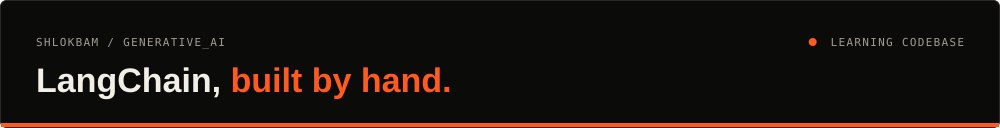
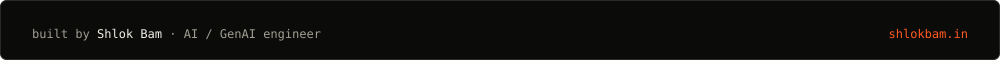

<div align="center">




<a href="https://generativeai-rag.streamlit.app/">RAG PDF Hub (live)</a> · <a href="#what-it-does">What it does</a> · <a href="#run-it">Run it</a> · <a href="docs/DETAILS.md">Full notes</a>

</div>

My working codebase from learning LangChain end to end: chat models and embeddings, a full RAG pipeline with a live Streamlit app, and LCEL runnables, tools and a LangGraph agent.

## What it does

- **Fundamentals:** chat with Groq and Hugging Face models, a CLI chatbot with memory, a Streamlit chat UI, and local `all-MiniLM-L6-v2` embeddings.
- **RAG Project ([live](https://generativeai-rag.streamlit.app/)):** loads PDFs, text and web pages, splits them, embeds with `mistral-embed` into Chroma, and retrieves with similarity, MMR, multi-query expansion and an arXiv retriever.
- **Agents:** sequence, parallel and passthrough runnables, custom tools, the bind → call → execute tool loop, a news summarizer, and a LangGraph ReAct agent with weather and news tools plus a trace panel.

## Stack

| Area | Tools |
| :--- | :--- |
| LLMs | Mistral (`open-mistral-7b`, `mistral-embed`), Groq, Hugging Face Hub |
| Retrieval | LangChain loaders and splitters, Chroma, MMR, multi-query, arXiv |
| Agents | LCEL runnables, `@tool`, LangGraph `create_react_agent`, Tavily, OpenWeatherMap |
| UI | Streamlit |

## Run it

```bash
# .env: MISTRAL_API_KEY, GROQ_API_KEY, HUGGINGFACEHUB_API_TOKEN (+ TAVILY_API_KEY for agents)
pip install -r RAG_Project/requirements.txt
python RAG_Project/Database.py                       # build the vector store
python -m streamlit run RAG_Project/streamlit_app.py # RAG app

pip install -r Fundamentals/requirements.txt
python -m streamlit run Fundamentals/chat_models/chatbot_ui.py
python -m streamlit run Agents/Tools/streamlit_app.py   # ReAct agent with traces
```

---

<div align="center">

<a href="https://shlokbam.in"></a>

<a href="https://shlokbam.in">shlokbam.in</a> · <a href="https://www.linkedin.com/in/shlokbam/">LinkedIn</a> · <a href="https://github.com/shlokbam">More projects</a>

</div>
